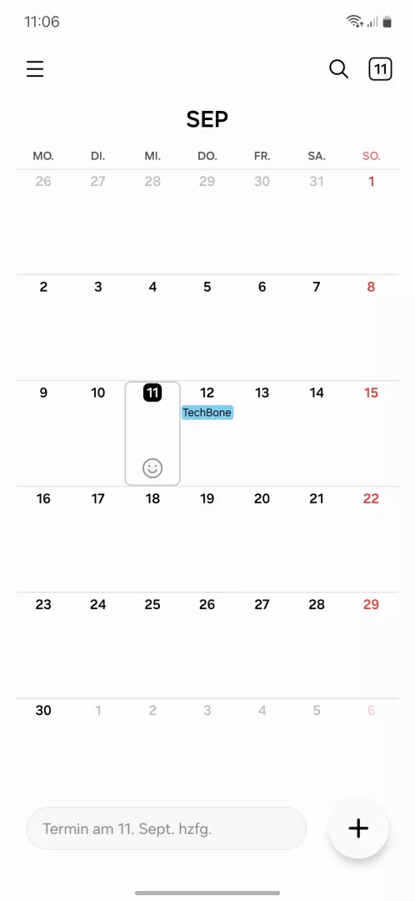
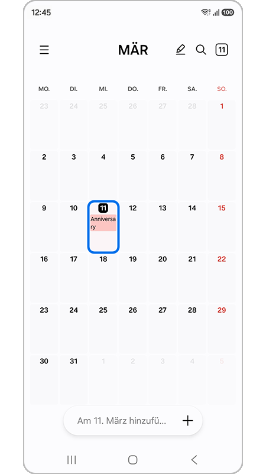
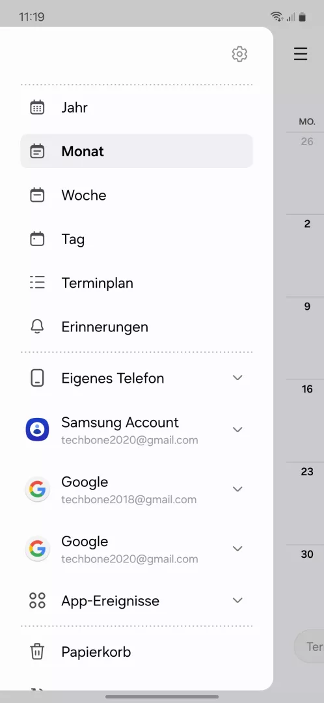

# Samsung Calendar

Samsung Galaxy

One UI 6 y Android 14 en TechBone; apoyo visual de Samsung sin versión exacta.

## Apariencia mensual

Diseño muy despejado y casi monocromo. El mes aparece centrado en mayúsculas, las líneas semanales son discretas y las fechas de meses vecinos se atenúan. Los eventos ocupan pequeñas bandas dentro de las celdas; la selección se distingue mediante un contorno vertical redondeado.

## Elementos

- Cabecera con menú, búsqueda y acceso a hoy.
- Cuadrícula de siete columnas con domingos en rojo.
- Evento con título dentro del día; selección con borde.
- Entrada rápida y botón más en la parte inferior.

## Navegación y continuidad

La guía oficial de Samsung de julio de 2022 indica deslizar a izquierda o derecha para cambiar de mes. Deslizar hacia arriba amplía información del día seleccionado; ese gesto no debe confundirse con un calendario mensual continuo.

Evidencia: Alta para la guía de 2022; no se ha ensayado la versión One UI 6.

## Icono

Icono oficial de fondo verde y hoja blanca. Se conserva el recurso publicado y su número de ejemplo.

## Pantallas

### Mes completo

Septiembre en One UI 6; permite estudiar la densidad y los límites de celda.

### Mes con evento

Referencia oficial con un evento y un día seleccionado; anotaciones del tutorial.

### Selección de vistas

Menú con Año, Mes, Semana, Día y agenda; se incluye como contexto.

## Alcance

Las capturas con anotaciones azules proceden del tutorial oficial; las flechas o bordes añadidos por la guía no son componentes permanentes de la aplicación.

## Fuentes

- [Guía visual One UI 6](https://www.techbone.de/samsung/galaxy/kalender-app-ansicht-aendern)
- [Pantallas e icono oficiales](https://www.samsung.com/de/support/mobile-devices/kalender-app-verwenden/)
- [Gestos oficiales de navegación, 2022](https://www.samsung.com/sg/support/mobile-devices/how-can-i-use-the-calendar-app-on-my-samsung-smartphone/)