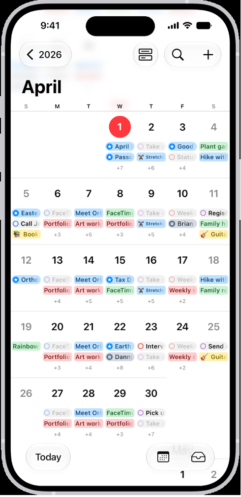
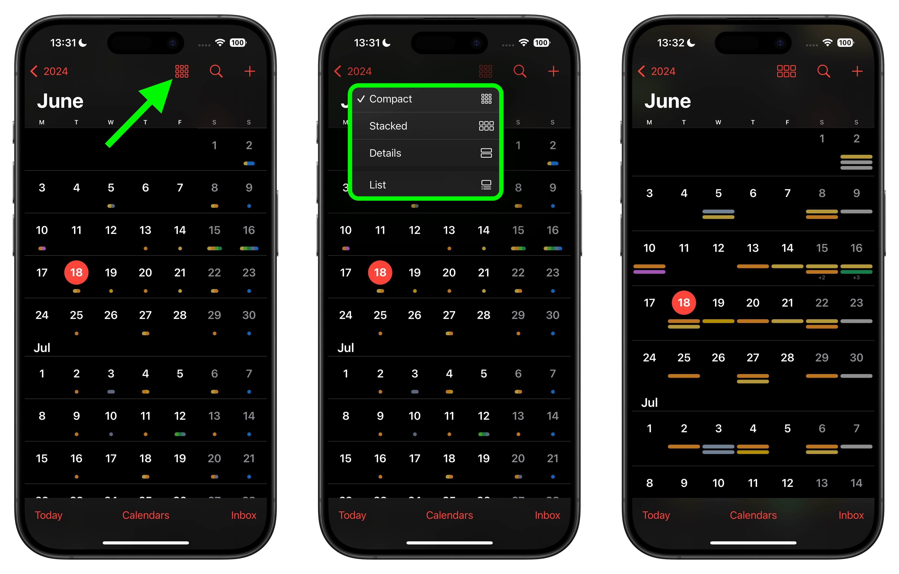
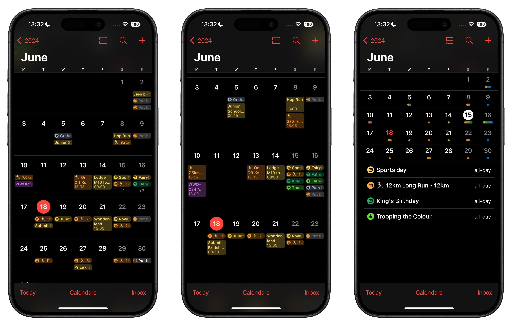

# Apple Calendar

iPhone y iOS

Guía oficial consultada en noviembre de 2026 y capturas de la beta iOS 18 publicadas en junio de 2024.

## Apariencia mensual

El nombre del mes es grande y contundente. El espacio entre semanas y el volumen de información cambian con el modo elegido: indicadores compactos, barras apiladas, títulos detallados o mes con lista inferior. En la beta oscura, las acciones usan rojo y los eventos adoptan colores de calendario.

## Elementos

- Nombre del mes y acceso al año.
- Selector de presentación, búsqueda y más.
- Separadores horizontales entre semanas.
- Eventos con texto o indicadores según el modo; controles inferiores.

## Navegación y continuidad

Es una referencia útil para una cuadrícula vertical de semanas y para variar la densidad. Las composiciones muestran continuaciones al borde inferior y filas de distinta altura. No se ha probado en dispositivo si la versión actual permite detener el desplazamiento libremente entre dos meses.

Evidencia: Alta para los modos oficiales; la continuidad libre no se certifica.

## Icono

Hoja clara con día de la semana y número. El icono de tienda es una referencia independiente de las capturas de iOS 18.

## Pantallas

### Mes con detalles en la guía oficial

Imagen de Apple consultada en 2026; terminal concreto no identificado.

### Modos de la beta iOS 18

Composición editorial con varios modos y anotaciones de MacRumors.

### Densidad y detalle en iOS 18 beta

Compara dos densidades mensuales y una vista con lista inferior.

## Alcance

Las imágenes de 2024 corresponden a una beta: no son capturas del iOS actual. La ilustración de Apple se identifica por separado.

## Fuentes

- [Modos mensuales oficiales](https://support.apple.com/en-gb/guide/iphone/iphfd1054569/ios)
- [Capturas de iOS 18 beta, junio de 2024](https://www.macrumors.com/2024/06/18/ios-18-whats-new-in-the-calendar-app/)
- [Icono de App Store](https://apps.apple.com/us/app/calendar/id1108185179?uo=4)