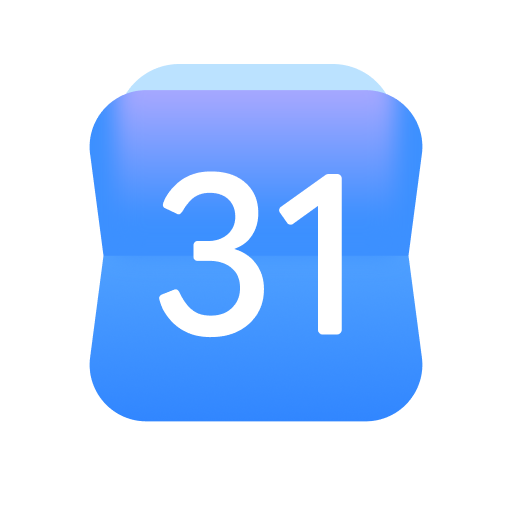
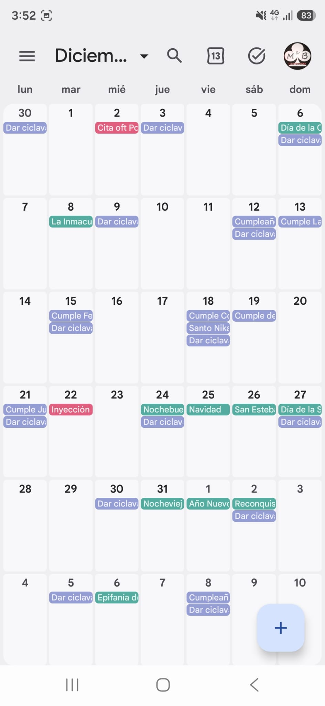
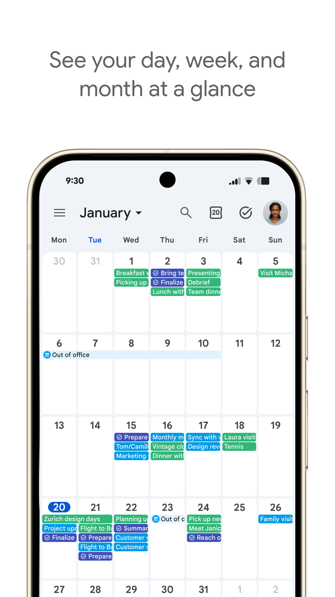
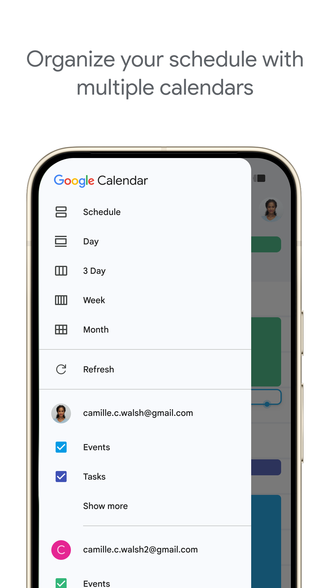

# Google Calendar

Pixel y otros Android, incluido Samsung

Imagen del usuario sin versión identificada y recursos de Google Play consultados el 19 noviembre 2026.

## Apariencia mensual

La referencia aportada organiza cada día como una tarjeta muy alta y redondeada sobre un fondo gris claro. Las etiquetas de evento son bandas de color con texto blanco truncado. La cabecera reúne el mes, búsqueda, hoy, tareas y cuenta; el botón más flota abajo a la derecha.

## Elementos

- Menú lateral y mes desplegable.
- Siete columnas y varias filas de días.
- Bandas de eventos por color de calendario.
- Fechas del mes vecino al final y botón más flotante.

## Navegación y continuidad

La ayuda oficial documenta la selección de Mes y un selector de fecha cuyos meses se recorren horizontalmente. Eso no prueba por sí solo el gesto de la cuadrícula principal. Hay reportes de usuarios de 2024 sobre paginación horizontal; la captura enviada no permite verificar el gesto ni un scroll mensual libre.

Evidencia: Alta para el diseño visible; limitada para el movimiento en la versión aportada.

## Icono

El recurso de tienda consultado tiene un 31 blanco sobre una forma azul con volumen. En capturas anteriores aparece el icono multicolor plano; no se mezclan como si fueran el mismo archivo.

## Pantallas

### La referencia aportada

Interfaz atribuible visualmente a Google Calendar sobre un Samsung; la versión de la aplicación no está identificada.

### Mes en la ficha de Google Play

Imagen promocional con marco de teléfono y texto comercial.

### Menú de vistas

Material promocional: incluye la opción Month y los calendarios visibles.

## Alcance

La imagen enviada parece Google Calendar por la cuenta, el acceso a tareas y la estructura de la cabecera. Es una atribución visual, no una lectura de la información de la app.

## Fuentes

- [Ayuda oficial de vistas](https://support.google.com/calendar/answer/6110849?co=GENIE.Platform%3DAndroid&hl=en)
- [Recursos oficiales de Google Play](https://play.google.com/store/apps/details?id=com.google.android.calendar)
- [Reporte comunitario sobre paginación, diciembre 2024](https://support.google.com/calendar/thread/312779741/google-calendar-s-core-navigation-is-fundamentally-counterintuitive?hl=en)