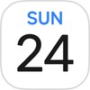
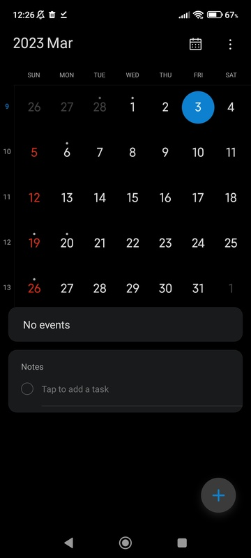
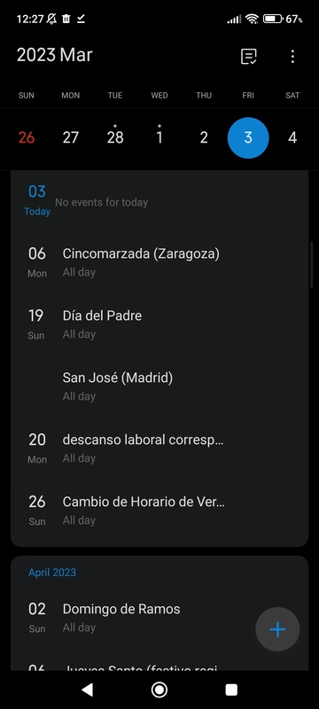
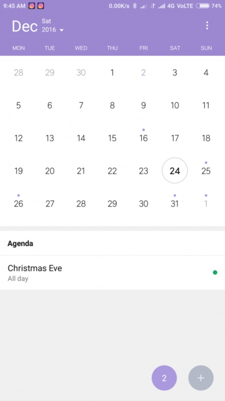
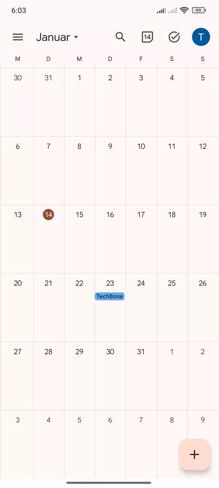

# Xiaomi Mi Calendar

MIUI y HyperOS; variante según región

Archivo de Uptodown con capturas de 2018 y 2023; no se conoce la versión exacta que produjo cada imagen.

## Apariencia mensual

La referencia propia de Xiaomi dedica la parte superior a un mes compacto y la inferior a tarjetas de agenda o notas. En oscuro, números blancos y grises sobre negro con un día seleccionado azul. La referencia antigua clara utiliza una cabecera lavanda. No llena cada día con grandes títulos como el ejemplo de Google.

## Elementos

- Cabecera de mes y selector de vista.
- Mes compacto de siete columnas.
- Selección circular azul y días adyacentes atenuados.
- Agenda, notas o módulos informativos bajo el mes.

## Navegación y continuidad

Las capturas prueban el mes y la agenda inferior, pero no el movimiento continuo entre meses. En Xiaomi también existe la variante Google Calendar: Xiaomi documenta esa app en REDMI Note 12 y la guía de HyperOS 2 la muestra explícitamente.

Evidencia: Alta para las imágenes; sin comprobación de continuidad de la app propia.

## Icono

Mi Calendar usa una hoja clara con SUN y número negro. Se añade también el icono Google observado en HyperOS 2 como variante separada.

## Pantallas

### Mi Calendar mensual oscuro

La imagen muestra marzo de 2023; versión exacta de captura desconocida.

### Agenda y franja de fechas

Vista alternativa para comparar la separación entre fechas y lista.

### Mi Calendar claro de archivo

Imagen con diciembre de 2018, cabecera lavanda y agenda inferior.

### Google Calendar en HyperOS 2

Android 15 y HyperOS 2 según TechBone. No es el diseño de Mi Calendar.

## Alcance

La ficha del repositorio puede mostrar hoy una versión nueva mientras mantiene capturas antiguas. No se atribuyen esas pantallas a HyperOS 4 ni a la versión anunciada en la ficha.

## Fuentes

- [Archivo visual Mi Calendar](https://xiaomi-calendar.en.uptodown.com/android)
- [Referencia clara antigua](https://mi-calendar.en.uptodown.com/android)
- [Google Calendar en HyperOS 2](https://www.techbone.de/xiaomi/smartphone/kalender-app-ansicht-aendern)
- [Xiaomi confirma Google Calendar en REDMI Note 12](https://www.mi.com/uk/support/article/KA-111344/)