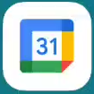
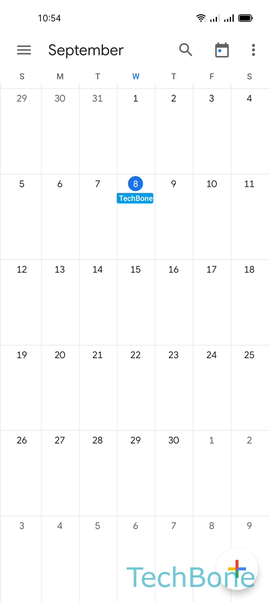
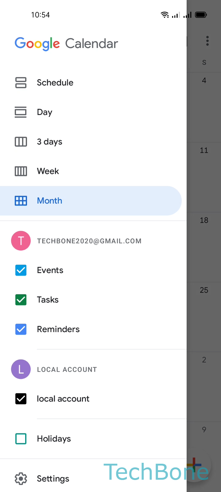

# Calendario observado en OPPO

OPPO y ColorOS 11

Android 11 y ColorOS 11 según la guía visual; aplicación identificada en su menú como Google Calendar.

## Apariencia mensual

La pantalla observada utiliza una cuadrícula mensual de gran altura, líneas finas grises y un pequeño evento azul. El día actual se marca con un círculo azul. El mes y los controles se alinean arriba; el botón de creación queda en la esquina inferior.

## Elementos

- Cabecera con menú, mes, búsqueda, hoy y opciones.
- Siete columnas con cinco o seis filas.
- Día destacado en azul y evento con título abreviado.
- Menú lateral con Month y el nombre Google Calendar.

## Navegación y continuidad

Para esta referencia se aplica la distinción de Google Calendar entre selector y cuadrícula principal. No se ha acreditado una modalidad de scroll mensual continuo ni se ha probado el gesto en ese terminal.

Evidencia: Alta para identificar Google: el menú lo nombra.

## Icono

El icono multicolor con 31 se recorta de la pantalla original para corresponder a esta referencia histórica, en lugar de sustituirlo por el icono de tienda actual.

## Pantallas

### Mes completo en OPPO

Captura de la guía ColorOS 11; contiene la marca de agua de TechBone.

### El menú identifica Google Calendar

Prueba visual de la aplicación utilizada en esta guía.

## Alcance

No se ha obtenido una secuencia mensual verificable de una app propia de OPPO para otras regiones. Este kit documenta la configuración observada y no la generaliza a todo ColorOS.

## Fuentes

- [Guía visual de OPPO](https://www.techbone.net/oppo/smartphone/calendar-view)
- [Ayuda de la aplicación Google Calendar](https://support.google.com/calendar/answer/6110849?co=GENIE.Platform%3DAndroid&hl=en)