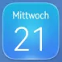
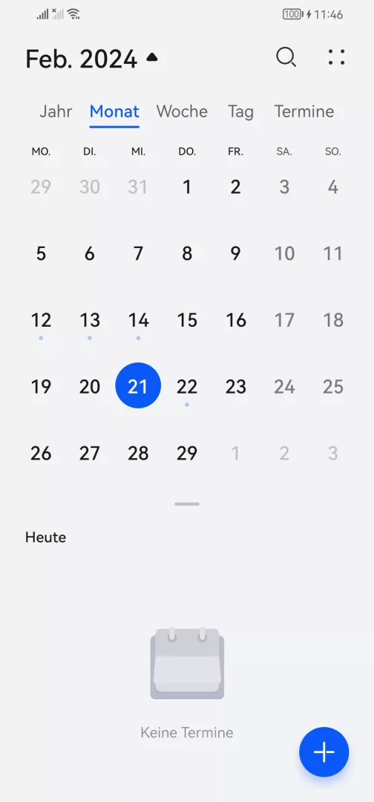
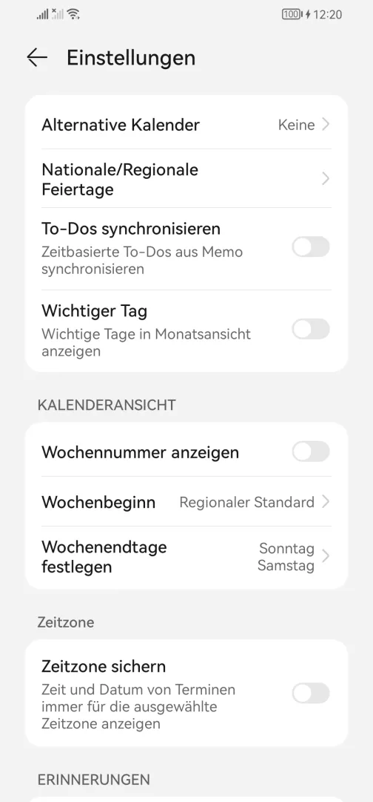

# Huawei Calendar

Huawei y EMUI 12

Android 10 y EMUI 12 según la secuencia visual.

## Apariencia mensual

La vista mensual ocupa aproximadamente la mitad superior; la inferior se reserva para la agenda del día. El diseño es blanco y gris, con acentos azules. Una fila de pestañas visibles hace explícitas las vistas Año, Mes, Semana, Día y eventos.

## Elementos

- Mes y año desplegables con búsqueda y menú.
- Pestañas de vistas inmediatamente debajo.
- Cuadrícula compacta y selección circular azul.
- Separador, agenda inferior y botón más azul.

## Navegación y continuidad

La coexistencia de mes y agenda se observa directamente. El desplazamiento de la agenda inferior no acredita continuidad de la cuadrícula mensual. La dirección y el ajuste final del gesto entre meses no se han comprobado para esta versión.

Evidencia: Alta para la composición; sin prueba del gesto mensual.

## Icono

Recorte de 77 píxeles con degradado azul, día de la semana y número 21. La fecha visible pertenece al instante capturado.

## Pantallas

### Mes con agenda del día

Muestra febrero de 2024 y el día seleccionado.

### Ajustes de presentación

Opciones de semana, días de fin de semana y otros ajustes; contexto de personalización.

## Alcance

Referencia EMUI 12: no se presenta como el calendario de HarmonyOS NEXT o de un dispositivo Huawei reciente.

## Fuentes

- [Secuencia EMUI 12](https://www.techbone.de/huawei/smartphone/kalender-app-wochenbeginn-aendern)