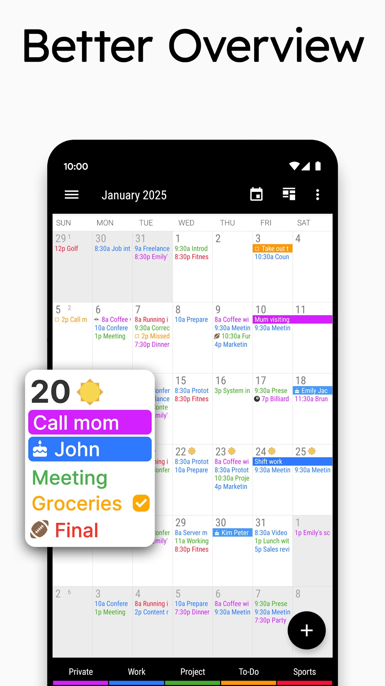
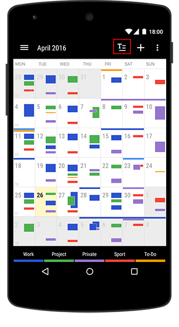
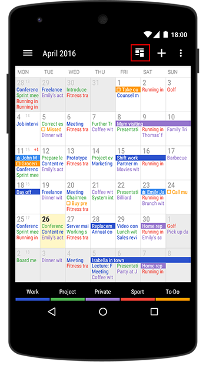
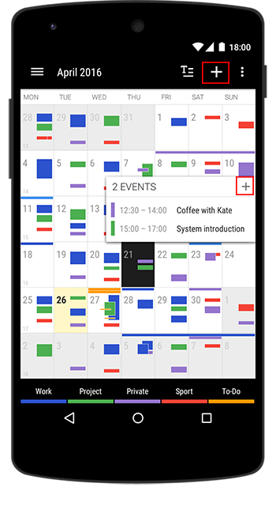

# Business Calendar 2

Android, alternativa especializada

Recursos de tienda consultados en 2026 y pantallas históricas de la ayuda del desarrollador.

## Apariencia mensual

Cuadrícula densa y funcional, con eventos presentados como texto o barras. Una barra inferior permite distinguir calendarios por color. La ayuda muestra una ventana de detalle sobre el propio mes. Los materiales de tienda ilustran también temas claros y oscuros.

## Elementos

- Mes y controles de vista en la cabecera.
- Celdas con barras o títulos, según presentación.
- Ventana superpuesta con los eventos del día.
- Barra de calendarios y acción de creación.

## Navegación y continuidad

Es el caso Android con continuidad documentada de forma explícita por su desarrollador: gestos verticales cortos ajustan al principio del mes; gestos largos recorren el límite entre meses; mantener el dedo y arrastrar permite avanzar gradualmente por semanas.

Evidencia: Alta documental; no se ha ejecutado la app en este trabajo.

## Icono

El recurso de tienda usa un 30 multicolor sobre fondo oscuro. No se interpreta ese número como la fecha dinámica del teléfono.

## Pantallas

### Mes en material de tienda

Imagen promocional con detalles superpuestos.

### Mes con barras

Referencia histórica de la ayuda del desarrollador.

### Mes con títulos

Mismo diseño de ayuda, con títulos en lugar de barras.

### Detalle sin abandonar el mes

Ventana del día sobre la cuadrícula mensual.

## Alcance

Las capturas del centro de ayuda tienen fechas de 2016 y 2020. Se separan de la promoción de tienda actual; algunas funciones y temas pueden depender de la edición.

## Fuentes

- [Desarrollador: continuidad y gestos](https://appgenix.uservoice.com/knowledgebase/articles/428537-using-the-month-view)
- [Funciones oficiales](https://www.appgenix-software.com/business-calendar-features/)
- [Icono y promoción de tienda](https://play.google.com/store/apps/details?id=com.appgenix.bizcal)