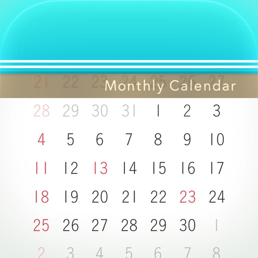
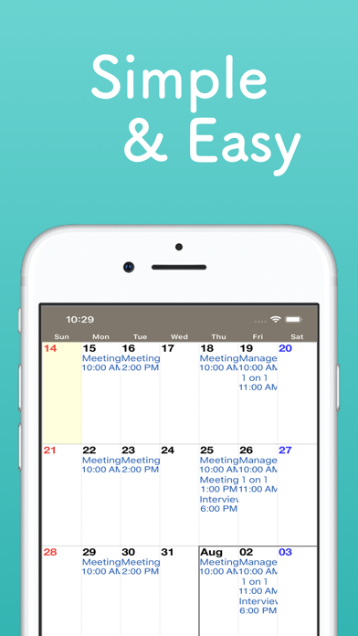
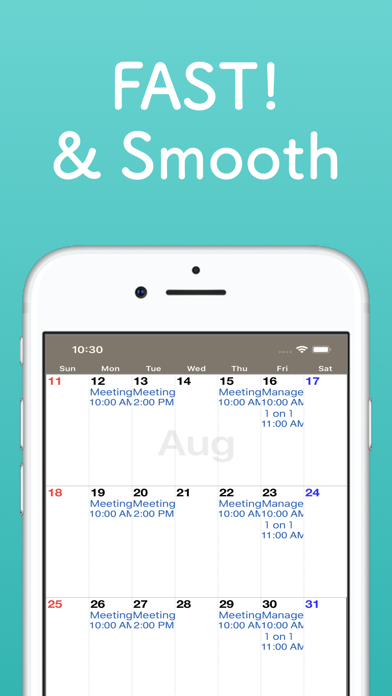
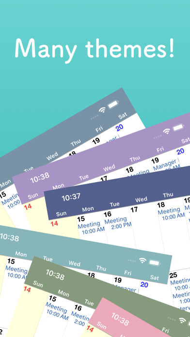

# Monthly Calendar Moca

iPhone, alternativa especializada

Recursos de App Store consultados el 19 noviembre 2026; las imágenes promocionales no identifican su versión de captura.

## Apariencia mensual

Presentación enfocada en el mes: cuadrícula fina, poco espacio decorativo y títulos pequeños por día. Una etiqueta de mes grande y muy tenue ayuda a situarse en la secuencia. La promoción muestra temas y controles de densidad sin abandonar la organización mensual.

## Elementos

- Cabecera semanal fija en la composición mostrada.
- Semanas enlazadas y rótulo tenue del mes.
- Títulos de eventos en el color de su calendario.
- Selección de día y herramientas en la parte inferior.

## Navegación y continuidad

La descripción publicada por el desarrollador en App Store indica meses unidos verticalmente y desplazamiento continuo hacia arriba o abajo, incluyendo la transición al mes siguiente. Es la referencia iPhone que mejor acredita documentalmente el patrón solicitado.

Evidencia: Alta documental; sin prueba de animación ni rendimiento.

## Icono

La imagen de tienda representa una pequeña hoja mensual bajo una cabecera turquesa. No es el icono de Apple Calendar.

## Pantallas

### Límite entre meses

Imagen promocional con semanas de julio y agosto en la misma secuencia.

### Rótulo de mes y cuadrícula

Promoción que presenta el desplazamiento como rápido y suave; no es una medición.

### Variaciones de tema

Material de tienda con varias paletas.

## Alcance

La promoción contiene marcos de iPhone antiguos. La fecha de consulta de la ficha no convierte esas imágenes en capturas recientes.

## Fuentes

- [Descripción y recursos del desarrollador en App Store](https://apps.apple.com/us/app/monthly-calendar-moca/id533031474)