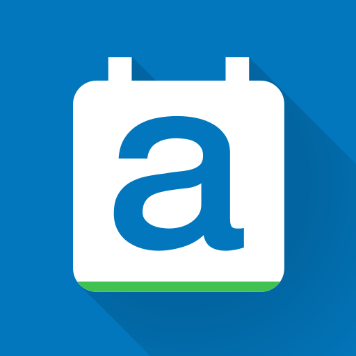
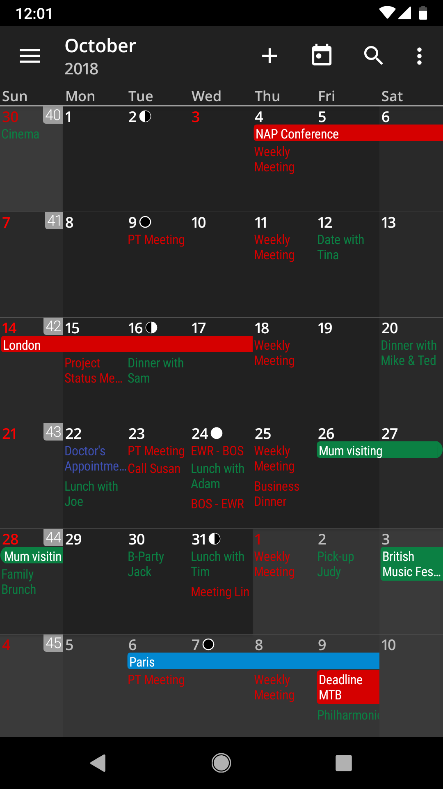
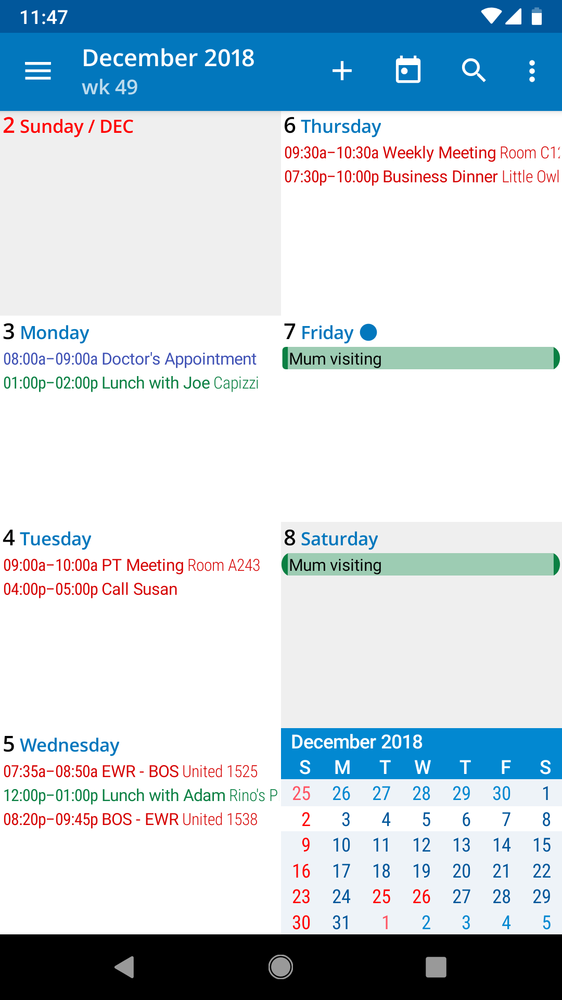

# aCalendar

Android, alternativa especializada

Captura mensual oscura de la ficha de Google Play con octubre de 2018; versión exacta de la imagen no indicada.

## Apariencia mensual

Cuadrícula de alta densidad, con pequeños títulos por día y barras que atraviesan varios días para eventos largos. En la muestra oscura, los fines de semana se distinguen con fondos de distinto tono y el evento usa color sobre el negro o gris del mes.

## Elementos

- Mes y herramientas en una cabecera compacta.
- Números de semana junto al calendario.
- Eventos como texto y bandas de varios días.
- Filas con días del siguiente mes al final.

## Navegación y continuidad

El desarrollador documenta arriba/abajo para ir al periodo anterior o siguiente y desplazamiento de dos dedos para saltos mayores. Izquierda/derecha cambia entre las vistas Mes, Semana y Día. Una navegación vertical por periodos no demuestra, por sí sola, continuidad libre entre semanas.

Evidencia: Alta para los gestos descritos por el desarrollador.

## Icono

Hoja blanca con una a azul, borde inferior verde y fondo azul. El recurso de tienda y la pantalla mensual pueden ser de generaciones distintas.

## Pantallas

### Mes de alta densidad

Captura publicada en Google Play; fecha visible de octubre de 2018.

### Semana como contexto

Vista semanal de la misma ficha; permite entender el cambio de vista, no se cuenta como mensual.

## Alcance

Se incorpora para distinguir dirección vertical de continuidad. No se presenta como otro ejemplo confirmado de la interacción de Business Calendar 2.

## Fuentes

- [Gestos oficiales](https://acalendar.tapirapps.de/en/support/solutions/articles/36000009791-navigation-in-day-week-and-month-view)
- [Icono y capturas de tienda](https://play.google.com/store/apps/details?id=org.withouthat.acalendar)